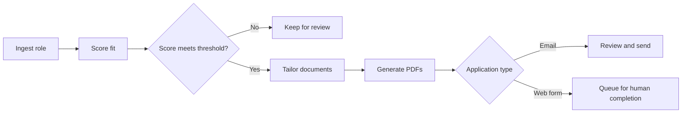

# Job Hunter Bot

A safe-by-default job application workflow that ingests opportunities, scores fit, generates tailored application documents, and automates only the application path that can be controlled reliably.

The system deliberately keeps web-form submission behind human review. Email applications can be sent through SendGrid after the user has reviewed the matched role and generated documents.

## What this project demonstrates

- End-to-end workflow automation with explicit safety boundaries
- TypeScript APIs built with Express and Zod
- Job-description ingestion and configurable match scoring
- Resume and cover-letter generation from HTML templates
- Headless Chrome PDF generation
- Authenticated API access and environment-based secret handling
- SQLite persistence for jobs and generated documents
- SendGrid email delivery with PDF attachments
- A Next.js dashboard for review, scoring, tailoring, and document access
- Human-in-the-loop product design for consequential actions

## Workflow



The default match threshold is `75` and can be changed with `MATCH_THRESHOLD`.

## Repository layout

```text
apps/
├── bot/
│   ├── src/index.ts         # Authenticated workflow API
│   ├── src/db.ts            # SQLite schema and persistence
│   ├── src/pdf.ts           # Headless Chrome PDF generation
│   └── src/sendgrid.ts      # Email delivery
└── dashboard/
    ├── app/page.tsx         # Job review dashboard
    ├── app/api/             # Server-side bot API proxy routes
    └── app/components/      # Ingestion, tailoring, and document UI
facts/                       # Structured career facts and schemas
```

## API capabilities

- `POST /jobs/ingest` — store a job opportunity
- `POST /jobs/:id/score` — calculate and persist a match score
- `POST /jobs/:id/tailor` — generate tailored HTML and PDF documents
- `POST /apply/email` — send reviewed documents by email
- `GET /jobs` — list recent jobs
- `GET /jobs/:id/docs/:kind` — retrieve generated documents

Protected endpoints use a bearer token when `BOT_API_TOKEN` is configured.

## Technology

TypeScript · Node.js · Express · Zod · SQLite · Next.js · React · SendGrid · Headless Chrome

## Run locally

Requirements: Node.js 20 or newer, npm, and Google Chrome.

### Bot API

```bash
cd apps/bot
npm install
npm run dev
```

The API listens on `http://127.0.0.1:8787` by default.

### Dashboard

```bash
cd apps/dashboard
npm install
npm run dev
```

Configure the dashboard with `BOT_API_URL` and, when enabled, `BOT_API_TOKEN`.

## Configuration

The bot reads environment variables including `MATCH_THRESHOLD`, `CHROME_PATH`, `BOT_API_TOKEN`, the `BASE_RESUME_*` paths, `SENDGRID_API_KEY`, `MAIL_FROM`, and `MAIL_FROM_NAME`. Secrets and private application data should remain outside Git.

## Safety decisions

- Web forms are not submitted automatically.
- API access can be protected with a bearer token.
- Application email requires a current immutable package explicitly approved with Maurice's separate credential.
- Inputs cross Zod validation boundaries before workflow execution.
- Credentials are supplied through environment variables rather than source code.

## Portfolio focus

## Notes
- Do not store secrets in git.
- Web-form auto-submission is intentionally NOT included in v1.

## Evidence context contract
Read `context/domain_rules.md` and `context/table_guide.md` before running this workflow. Mandatory qualifications need requirement-to-proof records; unknowns stay in review. Deterministic checks validate structure, not source truth or model accuracy.

## Maurice candidate approval service

The backend pins the policy copied from `dktrn9ne/job-search-agent` at blob
`c34748809902db9de9dd744f27aad398b35a9bbb` in `config/double-offer/maurice.policy.json`.
This service enforces candidate identity, candidate approval, authenticated review,
notification destination and requisition deduplication. Salary, location, qualification
and daily-volume policy evaluation remain outside this approval service.

Configure distinct random bearer secrets of at least 32 characters:
`BOT_API_TOKEN` for the operator and `MAURICE_APPROVAL_TOKEN` for Maurice alone.
Provision Maurice's secret through a private channel; never put it in a notification,
URL, browser local storage, shared dashboard configuration or repository. The separate
candidate credential is a single-candidate authentication mechanism, not an OIDC login.
Approval and submission endpoints fail closed when either role configuration is unsafe.
Existing ingest/tailor/read routes retain their prior development-mode authentication.
Deploy behind HTTPS with access controls and protect the SQLite database and backups.

Operator workflow:

1. Generate and replace placeholder materials with substantive reviewed HTML/PDF files
   in an existing documents record. There is no new document authoring/upload endpoint.
2. `POST /approval/packages` with `{candidateId:"maurice", jobId, documentId,
   requisitionId, toEmail, subject, text}` using the operator credential. Company and title
   must exist. The service checks HTML length, known placeholder markers and PDF headers,
   stores the exact HTML/PDF contents and message, and returns a pending version and digest.
   These checks cannot establish factual accuracy or full PDF/HTML semantic equivalence.
3. Set `CANDIDATE_REVIEW_URL` to an actual HTTPS candidate review client, then explicitly
   `POST /approval/packages/:id/notify` using the operator credential. Only a valid current
   pending package can trigger a notification, always to `mrthomaslmg@gmail.com`.
   Notifications contain an identifier and digest, no bearer credential or decision link.
4. Maurice retrieves `GET /approval/packages/:id` using his candidate credential. The
   response includes the full snapshot (PDFs as base64), version, digest and audit trail.
   After reviewing, he calls `POST /approval/packages/:id/decision` with
   `{digest, decision:"approve"}` or `"reject"`. GET requests never change decisions.
5. The operator can call `POST /apply/email` with **only** `{packageId}`. The old
   `{jobId,toEmail}` API is blocked. Only the latest explicitly approved version can send,
   with no recipient, message or attachment overrides. New versions supersede old approvals.

Notifications are explicitly triggered after package creation, not automatically sent by
package creation. Both mail paths use existing SendGrid configuration. No email is sent
by installation, startup, package creation, review, decision or the test suite.

Submission claims persist before the mail provider call; repeated and concurrent requests
cannot send the package again. Failures and interrupted sends become `SUBMISSION_UNCERTAIN`
and require manual provider reconciliation before any retry. Provider acceptance is logged
separately from employer confirmation; this service does not mark the job employer-confirmed.
Notification attempts are also claimed before sending and require reconciliation on failure.
Audit rows are append-only through SQLite triggers (not tamper-proof against database admins).

A candidate review UI, private credential provisioning, deployment, live provider validation,
material authoring, notification retry reconciliation and employer receipt reconciliation
are operational follow-ups. Web-form auto-submission remains absent and disabled.

Run backend checks with `cd apps/bot && npm ci && npm test` on Node 22 LTS with native
better-sqlite3 support. Tests use temporary databases and a fake mail provider.
