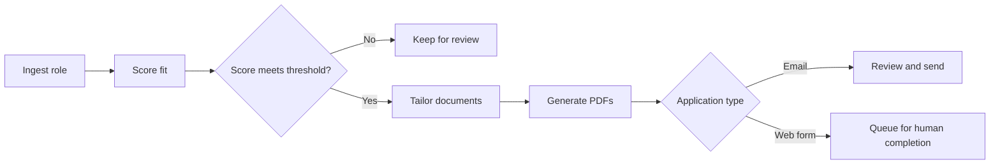

# Job Hunter Bot

A safe-by-default job application workflow that ingests opportunities, scores fit, generates tailored application documents, and automates only the application path that can be controlled reliably.

The system deliberately keeps web-form submission behind human review. Email applications can be sent through SendGrid after the user has reviewed the matched role and generated documents.

## What this project demonstrates

- End-to-end workflow automation with explicit safety boundaries
- TypeScript APIs built with Express and Zod
- Job-description ingestion and configurable match scoring
- Resume and cover-letter generation from HTML templates
- Headless Chrome PDF generation
- Authenticated API access and environment-based secret handling
- SQLite persistence for jobs and generated documents
- SendGrid email delivery with PDF attachments
- A Next.js dashboard for review, scoring, tailoring, and document access
- Human-in-the-loop product design for consequential actions

## Workflow



The default match threshold is `75` and can be changed with `MATCH_THRESHOLD`.

## Repository layout

```text
apps/
├── bot/
│   ├── src/index.ts         # Authenticated workflow API
│   ├── src/db.ts            # SQLite schema and persistence
│   ├── src/pdf.ts           # Headless Chrome PDF generation
│   └── src/sendgrid.ts      # Email delivery
└── dashboard/
    ├── app/page.tsx         # Job review dashboard
    ├── app/api/             # Server-side bot API proxy routes
    └── app/components/      # Ingestion, tailoring, and document UI
facts/                       # Structured career facts and schemas
```

## API capabilities

- `POST /jobs/ingest` — store a job opportunity
- `POST /jobs/:id/score` — calculate and persist a match score
- `POST /jobs/:id/tailor` — generate tailored HTML and PDF documents
- `POST /apply/email` — send reviewed documents by email
- `GET /jobs` — list recent jobs
- `GET /jobs/:id/docs/:kind` — retrieve generated documents

Protected endpoints use a bearer token when `BOT_API_TOKEN` is configured.

## Technology

TypeScript · Node.js · Express · Zod · SQLite · Next.js · React · SendGrid · Headless Chrome

## Run locally

Requirements: Node.js 20 or newer, npm, and Google Chrome.

### Bot API

```bash
cd apps/bot
npm install
npm run dev
```

The API listens on `http://127.0.0.1:8787` by default.

### Dashboard

```bash
cd apps/dashboard
npm install
npm run dev
```

Configure the dashboard with `BOT_API_URL` and, when enabled, `BOT_API_TOKEN`.

## Configuration

The bot reads environment variables including `MATCH_THRESHOLD`, `CHROME_PATH`, `BOT_API_TOKEN`, the `BASE_RESUME_*` paths, `SENDGRID_API_KEY`, `MAIL_FROM`, and `MAIL_FROM_NAME`. Secrets and private application data should remain outside Git.

## Safety decisions

- Web forms are not submitted automatically.
- API access can be protected with a bearer token.
- Application email requires generated documents and a valid recipient.
- Inputs cross Zod validation boundaries before workflow execution.
- Credentials are supplied through environment variables rather than source code.

## Portfolio focus

This repository models a real workflow, separates the API and review interface, preserves state, generates usable artifacts, and limits automation where human judgment remains important.
